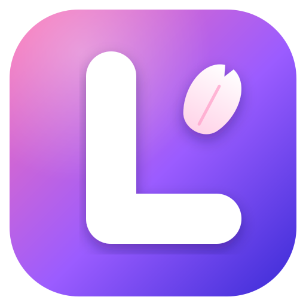

<p align="center">
  
</p>

<h1 align="center">LakuenLauncher</h1>

<p align="center">
  Dein Paradies (楽園, <i>Rakuen</i>) für Spiele & Apps unter SteamOS und Linux.<br>
  AppImages und Windows-Spiele an einem Ort – mit eigenem Artwork, Spielzeit-Statistik und ohne Konto.<br>
  <b>erstellt von Dominic Lesina x Claude</b>
</p>

<p align="center">
  <a href="https://github.com/elkarbeenus/Lakuenlauncher/releases/latest"></a>
  
  
</p>

---

## Funktionen

| | |
|---|---|
| 🎮 **Alles an einem Ort** | AppImages, Linux-Programme und Windows-Spiele (.exe) verwalten und starten |
| 🍷 **Proton eingebaut** | .exe-Dateien starten mit der neuesten Proton-Version oder Proton Experimental – automatisch erkannt (Steam, GE-Proton, Flatpak) |
| 🖼️ **Eigenes Artwork** | Cover, Banner, Logo und Icon pro Spiel – wie bei Nicht-Steam-Spielen in Steam. Bilder einfach ins Fenster ziehen |
| ⏱️ **Spielzeit & Statistik** | Zählt nur Starts über den Launcher. Verlauf, Aktivitätskalender, Top-Spiele, Serien |
| 🔍 **Schnell** | Strg+K-Befehlspalette, Drag & Drop, Ordner-Scan, beobachtete Ordner, Tastenkürzel, Controller |
| 🎨 **Themes** | 8 dunkle + 3 helle Themes, eigene Akzentfarbe, **externe Themes per JSON** |
| 🔔 **Updates** | Prüft die GitHub-Releases und meldet neue Versionen per Benachrichtigung |
| 🔒 **Privat** | Kein Konto, keine Telemetrie. Alles bleibt lokal auf deinem Gerät |

Weitere Komfortfunktionen: Sammlungen, Favoriten, Ausblenden, „Weiterspielen“-Banner, eigener Wine-Prefix pro Spiel, winecfg/winetricks-Knöpfe, MangoHud/GameMode/FSR/gamescope pro Spiel, Umgebungsvariablen, Skripte vor/nach dem Start, Startprotokoll, Desktop-Verknüpfungen, Export/Import und tägliche Sicherungen, Tutorial beim ersten Start.

## Installation (SteamOS / Linux)

1. Die neueste `LakuenLauncher_x.y.z_amd64.AppImage` von den [Releases](https://github.com/elkarbeenus/Lakuenlauncher/releases/latest) herunterladen.
2. Ausführbar machen: Rechtsklick → Eigenschaften → Berechtigungen → „Ausführbar“ – oder im Terminal:
   ```bash
   chmod +x LakuenLauncher_*.AppImage
   ```
3. Doppelklick zum Starten. Fertig.

**Update:** Der Launcher meldet neue Versionen. Einfach die alte AppImage durch die neue ersetzen – Bibliothek, Artwork und Statistik bleiben erhalten.

### Für Windows-Spiele

Mindestens eine Proton-Version muss installiert sein:
- In Steam: Bibliothek → Werkzeuge → **Proton Experimental** (oder Proton 10) installieren, oder
- **GE-Proton** mit [ProtonUp-Qt](https://davidotek.github.io/protonup-qt/) installieren.

Optional, aber empfohlen: [umu-launcher](https://github.com/Open-Wine-Components/umu-launcher). Ist er installiert, nutzt LakuenLauncher ihn automatisch.

**Startmethoden** (Einstellungen → Start & Proton):

| Methode | Beschreibung |
|---|---|
| Automatisch | umu-launcher falls vorhanden, sonst Proton in der Steam Linux Runtime, sonst Proton direkt |
| umu-launcher | Proton im Steam-Runtime-Container inkl. Spiel-Fixes (protonfixes) |
| Proton + Steam Runtime | wie Steam selbst: Proton in der Steam Linux Runtime (sniper) |
| Proton direkt | Proton-Skript ohne Container |

## Bedienung

- **Hinzufügen:** Knopf „Hinzufügen“, Strg+N, Dateien ins Fenster ziehen oder einen Ordner durchsuchen lassen (Strg+Umschalt+N)
- **Starten:** Play-Knopf, Doppelklick, Leertaste oder Controller-A
- **Bearbeiten:** Rechtsklick → Bearbeiten (Name, Artwork, Proton, Startoptionen)
- **Schnellsuche:** Strg+K – Spiel tippen, Enter, los geht’s
- **In Steam einbinden:** Rechtsklick → „Verknüpfung erstellen“, dann in Steam „Ein Nicht-Steam-Spiel hinzufügen“. Die Spielzeit zählt auch dann im Launcher.

## Externe Themes

Eigene Themes sind einfache JSON-Dateien. Einstellungen → Darstellung → „Vorlage speichern“, Farben anpassen, „Theme importieren“. Beispiel: [`themes/beispiel-theme.json`](themes/beispiel-theme.json)

```json
{
  "name": "Mein Theme",
  "author": "Dein Name",
  "mode": "dark",
  "colors": {
    "bg": "#0c0a12", "bg2": "#13101c", "panel": "#1a1526",
    "text": "#f4f0fa", "dim": "#a59db8",
    "accent": "#ff6fae", "accent2": "#9b5cff"
  },
  "onAccent": "#ffffff",
  "css": "/* optional: eigenes CSS */"
}
```

Pflicht sind `bg`, `panel`, `text` und `accent`. `mode` ist `dark` oder `light`.

## Datenschutz

LakuenLauncher braucht **kein Konto** und sendet **keine Daten**. Alles liegt lokal unter
`~/.local/share/de.lakuen.launcher/` (Bibliothek, Einstellungen, Spielzeiten, Artwork, Prefixe, Protokolle, Sicherungen).
Die einzige Internetverbindung ist die optionale Update-Prüfung bei der GitHub-API – abschaltbar in den Einstellungen.

## Selbst bauen

Voraussetzungen: Rust (stable), Node.js 20+, Tauri-Abhängigkeiten (`libwebkit2gtk-4.1-dev`, `librsvg2-dev`, `patchelf` …).

```bash
npm install
npm run dev      # Entwicklungsmodus
npm run build    # AppImage + .deb unter src-tauri/target/release/bundle/
npm run preview  # Nur Oberfläche im Browser (Demo-Modus mit Beispieldaten)
```

Releases baut GitHub Actions automatisch: Version in `src-tauri/tauri.conf.json` (und `package.json`, `Cargo.toml`) erhöhen, `CHANGELOG.md` ergänzen und auf `main` pushen – Tag und Release mit AppImage entstehen dann von selbst.

### Aufbau

```
src/              Oberfläche (HTML/CSS/JavaScript, ohne Build-Schritt)
  js/app.js       Start, Navigation, Tastenkürzel, Drag & Drop
  js/library.js   Bibliothek & Detailseite
  js/editor.js    Spiel-Editor (Name, Artwork, Proton, Optionen)
  js/stats.js     Statistik
  js/settings.js  Einstellungen
  js/extras.js    Befehlspalette, Tutorial, Controller
src-tauri/src/    Rust-Backend
  runner.rs       Starten (AppImage / umu / Steam Runtime / Proton), Spielzeit-Messung
  proton.rs       Proton- & Steam-Runtime-Erkennung
  scan.rs         Ordner-Scan
  store.rs        Lokale JSON-Ablage, Artwork, Sicherungen
  platform.rs     System-Hilfen (Linux; Windows vorbereitet)
```

## Fahrplan

- Windows-Version (.exe-Setup) – die Grundlagen sind im Code bereits vorbereitet
- Optionale Cover-Suche (z. B. SteamGridDB mit eigenem API-Key)
- Direktes Selbst-Update der AppImage
- Vollbild-/Gaming-Modus für das Steam Deck
- Mehrsprachigkeit

## Danke & Inspiration

- [Tauri](https://tauri.app) (MIT/Apache-2.0)
- [Valve Proton](https://github.com/ValveSoftware/Proton) & Steam Linux Runtime
- [umu-launcher](https://github.com/Open-Wine-Components/umu-launcher) – wird nur aufgerufen, falls installiert (kein Code übernommen)
- Inspiration: [Playnite](https://github.com/JosefNemec/Playnite) (MIT), [clear](https://github.com/adithyasource/clear) (Unlicense)

Logo und Icons sind eigene Entwürfe.

## Lizenz

[MIT](LICENSE) © 2026 Dominic Lesina x Claude
