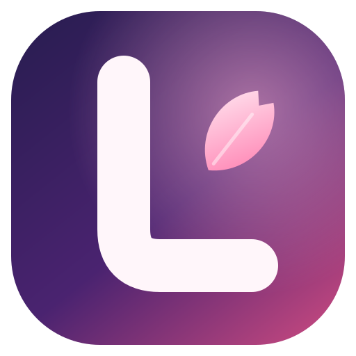

<p align="center">
  
</p>

<h1 align="center">LakuenLauncher</h1>

<p align="center">
  Lokaler Spiele- und App-Launcher für SteamOS und Linux.<br>
  AppImages und Windows-Spiele (.exe über Proton) an einem Ort – mit eigenem Artwork und Spielzeit-Statistik.<br>
  <sub>erstellt von Dominic Lesina x Claude</sub>
</p>

---

## Funktionen

**Bibliothek**
- AppImages, Windows-Spiele (.exe) und Linux-Programme hinzufügen: per Dateiauswahl, **Drag & Drop** oder **Ordner-Scan**
- Eigene Anzeigenamen, Sammlungen, Favoriten, Notizen, Ausblenden
- Eigenes Artwork pro Spiel: **Cover, Banner, Logo, Icon** (wie bei Nicht-Steam-Spielen in Steam) – ohne Artwork entsteht automatisch ein schönes Cover
- Raster- und Listenansicht, Kartengröße einstellbar, Sortierung nach zuletzt gespielt / Name / Spielzeit / hinzugefügt
- Bühne „Weiterspielen“ mit dem zuletzt gespielten Spiel

**Starten**
- `.exe` automatisch über **Proton Experimental** oder die **neueste Proton-Version** (offiziell, GE-Proton und eigene Versionen werden erkannt, auch Steam-Bibliotheken auf SD-Karte)
- Start über **umu-launcher**, wenn installiert (sonst direkt über Proton)
- Eigener Wine-Prefix pro Spiel, winecfg und winetricks direkt aus dem Launcher
- Startoptionen wie in Steam inkl. `%command%`, Umgebungsvariablen, Arbeitsordner
- Schalter für **MangoHud**, **GameMode** und **FSR**
- Skripte vor dem Start und nach dem Beenden
- Startprotokoll pro Spiel zur Fehlersuche
- Desktop-/Menü-Verknüpfungen, die über den Launcher starten (lassen sich als Nicht-Steam-Spiel in Steam eintragen)

**Spielzeit**
- Gezählt wird **nur**, was über den Launcher gestartet wurde (inklusive aller Unterprozesse von Proton)
- Spielzeit pro Spiel, Sitzungsliste, Diagramm der letzten 30 Tage
- Statistik: Spielzeit pro Tag/Woche/Monat, Aktivitätskalender, meistgespielte Spiele, Tageszeit, längste Sitzung, Serie

**Komfort**
- Schnellsuche mit <kbd>Strg</kbd>+<kbd>K</kbd> – Spiel tippen, Enter, läuft
- Tastatursteuerung mit Pfeiltasten (praktisch am Steam Deck)
- 9 eingebaute Themes (dunkel und hell, inkl. OLED-Schwarz), eigene Akzentfarbe, **externe Themes** als JSON
- Einführung beim ersten Start, jederzeit in den Einstellungen erneut abrufbar
- Update-Prüfung über GitHub-Releases mit Desktop-Benachrichtigung
- Sicherung exportieren/importieren

**Datenschutz**
- Kein Konto, keine Anmeldung, keine Telemetrie
- Alle Daten liegen lokal unter `~/.local/share/de.lesina.lakuenlauncher/`
- Die einzige Netzwerkverbindung ist die (abschaltbare) Update-Prüfung bei GitHub

## Installation (SteamOS / Linux)

1. Unter [Releases](https://github.com/elkarbeenus/Lakuenlauncher/releases) die Datei `LakuenLauncher_x.y.z_amd64.AppImage` herunterladen.
2. Ausführbar machen: Rechtsklick → Eigenschaften → Berechtigungen → „Ausführbar“, oder im Terminal
   ```bash
   chmod +x LakuenLauncher_*_amd64.AppImage
   ```
3. Doppelklick zum Starten.

**Für Windows-Spiele** wird Proton aus Steam benötigt (z. B. „Proton Experimental“ unter Bibliothek → Tools installieren). Empfohlen, aber optional: [umu-launcher](https://github.com/Open-Wine-Components/umu-launcher).

**Im Gaming-Modus:** Im Desktop-Modus über „Verknüpfung anlegen“ einen Menüeintrag erstellen und ihn in Steam über „Spiel hinzufügen → Nicht-Steam-Spiel hinzufügen“ eintragen.

## Eigene Themes

Siehe [docs/THEMES.md](docs/THEMES.md) – ein Beispiel liegt unter [themes/beispiel-sakura-neon.json](themes/beispiel-sakura-neon.json).

## Selbst bauen

Voraussetzungen: Rust (stable), Node.js 20+, unter Linux zusätzlich `libwebkit2gtk-4.1-dev libappindicator3-dev librsvg2-dev patchelf`.

```bash
npm install
npm run dev      # Entwicklungsmodus
npm run build    # AppImage unter src-tauri/target/release/bundle/appimage/
```

Die Oberfläche (`ui/`) ist reines HTML/CSS/JavaScript ohne Build-Schritt. Im Browser geöffnet (z. B. `python3 -m http.server` im Ordner `ui`) läuft sie mit Beispieldaten.

## Releases

Ein Tag `vX.Y.Z` startet den GitHub-Workflow, der das AppImage baut und mit den Notizen aus `CHANGELOG.md` veröffentlicht. Die Update-Prüfung im Launcher liest genau diese Releases.

## Projektaufbau

```
ui/                 Oberfläche (HTML, CSS, JavaScript-Module)
src-tauri/src/
  lib.rs            Einstieg, Befehle, Single-Instance
  storage.rs        lokale JSON-Daten, Artwork, Themes
  proton.rs         Proton-/Werkzeug-Erkennung
  launcher.rs       Starten, Beenden, Spielzeit messen
  platform.rs       Betriebssystem-spezifisches (Linux fertig, Windows vorbereitet)
.github/workflows/  CI und Release-Build
```

## Windows

Die Grundlagen sind gelegt: Alles Betriebssystem-Spezifische steckt in `platform.rs` bzw. hinter `cfg(windows)`. Unter Windows werden .exe-Dateien direkt gestartet. Der Release-Workflow enthält bereits einen (noch auskommentierten) Windows-Build.

## Lizenz

MIT – siehe [LICENSE](LICENSE). Logo und Oberfläche sind eigene Entwürfe.
